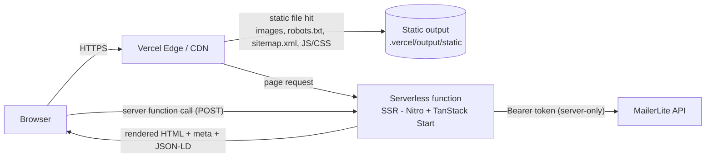

# TALENTS LAB — Official Website

> Server-side rendered, multilingual website for **TALENTS LAB**, a Brawl Stars esports organization and talent incubator.

**Live:** [www.talentslab.gg](https://www.talentslab.gg) · **Hosting:** Vercel (serverless SSR) · **Status:** in production


---

## Table of contents

1. [Overview](#overview)
2. [Tech stack](#tech-stack)
3. [Architecture](#architecture)
4. [Key engineering decisions](#key-engineering-decisions)
5. [Project structure](#project-structure)
6. [Routes](#routes)
7. [Getting started](#getting-started)
8. [Environment variables](#environment-variables)
9. [Build & deployment](#build--deployment)
10. [Code quality](#code-quality)
11. [Known limitations & roadmap](#known-limitations--roadmap)

---

## Overview

The site is the public face of the organization: it presents the rosters, publishes news, promotes upcoming merchandise and pitches partnership opportunities to sponsors.

**Main features**

- **Server-side rendering (SSR)** on Vercel serverless functions — full HTML on first response, good for SEO and social previews.
- **4 languages** (English, Italian, Spanish, French) with a hydration-safe language switcher.
- **Newsletter subscription** through MailerLite, proxied by a type-safe server function so the API token never reaches the browser.
- **SEO toolkit**: per-page meta tags, Open Graph / Twitter cards, `schema.org` Organization JSON-LD, `sitemap.xml`, `robots.txt`, canonical domain, 301 redirect for legacy URLs.
- **Performance work** on Core Web Vitals: responsive LCP image preloading, lazy-loaded below-the-fold images, early logo preload.
- **Accessible motion**: scroll-reveal animations that are disabled when the OS "reduce motion" setting is on.
- **Resilient UI**: image fallbacks for missing assets, layered SSR error handling, custom 404 and error pages.

---

## Tech stack

| Layer | Technology | Why |
| --- | --- | --- |
| Language | **TypeScript 5.8** (`strict` mode) | End-to-end type safety, including client ↔ server calls |
| UI | **React 19** | Component model, SSR + hydration |
| Meta-framework | **TanStack Start** (on Vite 7 + Nitro) | SSR, file-based routing, type-safe server functions |
| Routing | **TanStack Router** | Fully typed routes, per-route `head()` for meta tags, `beforeLoad` redirects |
| Data / state | **TanStack Query** | Query client wired into the router context |
| Styling | **Tailwind CSS 4** + CSS variables (OKLCH colors) | Utility-first styling, single design-token source |
| Icons & utilities | **lucide-react**, `clsx` + `tailwind-merge` (`cn()` helper), `tw-animate-css` | Tree-shakable SVG icons, conflict-free class merging, CSS animation utilities |
| Animation | **Framer Motion** | Viewport-triggered reveals with `useReducedMotion` |
| i18n | **i18next** + **react-i18next** | Translations bundled statically (EN/IT/ES/FR) |
| Validation | **Zod** | Server-side input validation for server functions |
| Email marketing | **MailerLite API** | Newsletter + "notify me" merchandise drop list |
| Server runtime | **Nitro** (`vercel` preset) | Builds the Vercel Build Output API (`.vercel/output`) |
| Hosting | **Vercel** | Static assets on the CDN, SSR on serverless functions (region `fra1`) |
| Build | Vite 7 + Lightning CSS | Fast dev server, same CSS pipeline in dev and build |
| Tooling | ESLint 9 (flat config), typescript-eslint, Prettier | Linting + formatting |

---

## Architecture

### High-level view



- Requests for files in `public/` are served directly by the Vercel CDN, **before** the SSR function runs.
- Every page request is rendered on the server by React 19, so crawlers and chat apps (WhatsApp, X, LinkedIn) get the full HTML and meta tags without running JavaScript.
- After load, the client **hydrates** the page and from then on navigation is client-side (SPA-like) through TanStack Router.

### Request lifecycle (SSR)

```
Request
  └─ src/server.ts          custom server entry: wraps TanStack Start's handler,
  │                         catches crashes and turns them into a branded 500 page
  └─ src/start.ts           request middleware (error boundary for the request pipeline)
      └─ src/router.tsx     creates the router + a QueryClient per request
          └─ routes/__root.tsx   HTML shell, global <head> (meta, favicon, JSON-LD),
              │                  i18n provider, 404 & error components
              └─ routes/<page>.tsx   page component + page-specific head() meta
```

### Newsletter flow (server function)

```
Footer / Shop form
  └─ useNewsletterForm(source)          shared hook: client-side checks, UI state machine
      └─ subscribeToNewsletter()        createServerFn — called like a normal async function,
          │                             executed only on the server (RPC over HTTP POST)
          ├─ Zod validation             { email: string().email(), source: "footer" | "shop" }
          ├─ getServerConfig()          reads MAILERLITE_API_KEY from *.server.ts (never bundled
          │                             for the client)
          └─ POST connect.mailerlite.com/api/subscribers
                201 → "subscribed"   200 → "already"   422 → "invalid_email"
                missing key → "not_configured"   other → "error"
```

The result is a **discriminated union** (`NewsletterResult`) so the UI can show a precise, translated message for each outcome.

---

## Key engineering decisions

These are the non-obvious problems solved during development, documented in code comments as well.

### 1. Secrets stay on the server
- The MailerLite token is **not** prefixed with `VITE_`: any `VITE_*` variable gets inlined into the client bundle and would be readable by anyone.
- Server-only config lives in `src/lib/config.server.ts`; the `.server.ts` suffix prevents Vite from bundling it for the browser. An ESLint rule blocks the Next.js-only `server-only` package to avoid a false sense of safety.
- Env vars are read **inside** functions (per request), not at module scope, so the code also works on runtimes that bind env at request time (e.g. Cloudflare Workers).
- In development, a small loader re-reads `.env` on each call so a changed token is picked up without restarting; in production the hosting panel variables always win.
- Calling MailerLite from the browser would not work anyway (no CORS headers) — the server function is the correct design, not just the safer one.

### 2. Hydration-safe internationalization
- Translations are **statically imported** JSON files, so they are inside the bundle and identical in dev, SSR and the serverless function (which has no `src/locales` folder on disk).
- The server and the first client render **always use English**; the user's saved language (localStorage) is applied only **after mount** (`syncLanguageWithBrowser`). This avoids React hydration mismatches.
- `<html lang>` is kept in sync on every language change.
- **Production bug fixed:** a side-effect-only `import "../lib/i18n"` was removed by tree-shaking (`sideEffects: false`), so Vercel showed raw keys like `NAVBAR.HOME`. Fixed by initializing i18n through an explicit returned instance (`initI18n()`) passed to `<I18nextProvider>`.
- `initI18n()` is **idempotent** because warm serverless instances reuse modules across requests.
- Missing keys fall back to the last key segment instead of showing a raw dotted path.

### 3. SEO & social sharing
- A single `socialMeta()` helper builds title, description, Open Graph and Twitter tags for every route, so pages can't drift apart.
- **Canonical domain is `www.talentslab.gg`**: the apex domain answers with a 308 redirect, and WhatsApp does not follow redirects when downloading `og:image` — so absolute URLs always use `www`.
- The OG image is a 1200×630 PNG on an **opaque** background (WhatsApp composites transparent PNGs on white, which made the white logo invisible).
- `schema.org` **Organization** JSON-LD with logo and `sameAs` social profiles; `<` is escaped when serializing to prevent breaking out of the `<script>` tag.
- `sitemap.xml` lists only ranking-relevant pages (legal pages excluded on purpose).
- The old Italian URL `/chi-siamo` returns a **301** to `/about` to transfer ranking and avoid duplicate content.

### 4. Performance (Core Web Vitals)
- The home hero uses `<picture>` with separate mobile/desktop images; the matching `<link rel="preload">` tags carry the **same `media` queries**, so the browser downloads only one ~2 MB image instead of both.
- The LCP image uses `fetchPriority="high"` and is never lazy-loaded; everything below the fold uses `loading="lazy"` + `decoding="async"`.
- The navbar logo (29 KB, on every page) is preloaded globally.
- Google Fonts are loaded with `preconnect` and `display=swap`.

### 5. Resilience & error handling
- **Three layers**: React error component in the root route → request middleware in `start.ts` → custom server entry in `server.ts`.
- `server.ts` detects the generic 500 JSON that h3 produces when it swallows an exception, recovers the original error (captured out-of-band in `error-capture.ts`) for logging, and returns a proper HTML error page.
- Images (news covers, roster photos, hero) fall back to a branded placeholder via `onError`, so a missing asset never shows a broken image.

### 6. Content model
- `src/lib/news.ts` is the **single source of truth** for news: both `/news` and the home "Latest News" section read from it. The home shows the 2 most recent items automatically, sorted by `publishedAt`.
- Text lives in the locale files; code holds only ids, dates and image paths.

### 7. Accessibility
- `ScrollReveal` uses Framer Motion's `useReducedMotion()` and renders static content for users who disabled animations.
- Semantic headings, `alt` text, readable contrast on a dark OKLCH palette.

---

## Project structure

```
.
├── README.md
└── neon-dominance-main/            # application root (Vercel "Root Directory")
    ├── public/                     # static assets served by the CDN
    │   ├── news/  shop/            # article covers, merchandise images
    │   ├── og-image.png            # 1200×630 social preview
    │   ├── robots.txt  sitemap.xml
    │   └── ...                     # logo, favicon, hero images
    ├── src/
    │   ├── server.ts               # custom SSR server entry (error normalization)
    │   ├── start.ts                # TanStack Start instance + request middleware
    │   ├── router.tsx              # router factory (QueryClient in context)
    │   ├── routeTree.gen.ts        # auto-generated route tree (do not edit)
    │   ├── styles.css              # Tailwind 4 + design tokens (OKLCH)
    │   ├── routes/                 # file-based routes (one file = one URL)
    │   │   ├── __root.tsx          # HTML shell, global head, providers, 404/error
    │   │   ├── index.tsx           # home
    │   │   ├── about.tsx  chi-siamo.tsx (301 → /about)
    │   │   ├── teams/index.tsx
    │   │   ├── news.tsx  shop.tsx  partner.tsx
    │   │   └── privacy-policy.tsx  cookie-policy.tsx  termini.tsx
    │   ├── components/site/        # Navbar, Footer, SiteLayout, LanguageSelector,
    │   │                           # ScrollReveal, NewsCover, LogoWatermark, social links
    │   ├── hooks/
    │   │   └── use-newsletter-form.ts
    │   ├── lib/
    │   │   ├── api/newsletter.functions.ts   # server function → MailerLite
    │   │   ├── config.server.ts              # server-only env access
    │   │   ├── i18n.ts                       # i18next setup + browser sync
    │   │   ├── seo.ts                        # meta tags, OG, JSON-LD helpers
    │   │   ├── news.ts                       # news data source
    │   │   ├── error-capture.ts  error-page.ts
    │   │   └── utils.ts                      # cn() class-name helper
    │   └── locales/                # en.json  it.json  es.json  fr.json
    ├── vite.config.ts              # plugins (TanStack Start, React, Tailwind, Nitro "vercel" preset)
    ├── eslint.config.js  .prettierrc  tsconfig.json
    └── package.json
```

---

## Routes

| URL | Page | Notes |
| --- | --- | --- |
| `/` | Home | Preloader splash, team hero (LCP-optimized), rosters, latest 2 news |
| `/about` | About | Story, mission, values, future plans |
| `/chi-siamo` | — | **301** redirect to `/about` (legacy URL) |
| `/teams` | Teams | Main roster and player cards with image fallback |
| `/news` | News | Article list sorted by date, expandable content |
| `/shop` | Shop | Upcoming merchandise drop + "notify me" (MailerLite, `source: "shop"`) |
| `/partner` | Partner | Sponsorship pitch and audience data |
| `/privacy-policy`, `/cookie-policy`, `/termini` | Legal | Excluded from the sitemap |

Every route defines its own `head()` with `socialMeta({ title, description, path })`.

---

## Getting started

**Requirements:** Node.js 22+ (developed on Node 24), npm.

```bash
cd neon-dominance-main
npm install
cp .env.example .env      # or create .env manually, see below
npm run dev               # http://localhost:8080
```

| Script | Description |
| --- | --- |
| `npm run dev` | Vite dev server with SSR on port 8080 |
| `npm run build` | Production build → `.vercel/output` (Nitro `vercel` preset) |
| `npm run build:dev` | Build in development mode |
| `npm run lint` | ESLint (TypeScript + React Hooks + Prettier rules) |
| `npm run format` | Prettier on the whole project |

---

## Environment variables

| Variable | Required | Scope | Description |
| --- | --- | --- | --- |
| `MAILERLITE_API_KEY` | yes (for the newsletter) | **server only** | MailerLite API token |
| `MAILERLITE_GROUP_ID` | no | server only | Adds subscribers to a specific MailerLite group |

- Local: put them in `neon-dominance-main/.env` (git-ignored).
- Production: set them in **Vercel → Project → Settings → Environment Variables**.
- Without the token the site still works; the forms show a "newsletter not active" message instead of a false success.

---

## Build & deployment

1. `vite build` runs TanStack Start + Nitro with `preset: "vercel"`.
2. Nitro emits the **Vercel Build Output API** structure:
   - `.vercel/output/static/` → assets from `public/` + hashed JS/CSS bundles (served by the CDN)
   - `.vercel/output/functions/__server.func/` → the SSR serverless function
3. Vercel deploys from the GitHub repository; the project's **Root Directory** is `neon-dominance-main/`.
4. Domains: `talentslab.gg` → **308** → `www.talentslab.gg` (canonical).

> `vite preview` is not used: with the Nitro `vercel` preset the build targets Vercel's serverless runtime, not a standalone Node server. The built function can be smoke-tested by importing `.vercel/output/functions/__server.func/index.mjs` and calling its `fetch(request)` handler.

---

## Code quality

- TypeScript `strict` mode, path alias `@/* → src/*`.
- ESLint 9 flat config: `typescript-eslint` recommended, `react-hooks`, `react-refresh`, Prettier integration; build output folders are ignored.
- `npx tsc --noEmit` and `npm run lint` pass with **0 errors**.
- Extensive in-code documentation explaining *why* decisions were made (SEO quirks, hydration, serverless constraints).

---

## Known limitations & roadmap

- **Images**: hero and gallery images are large PNGs (~1–2 MB). Next step: convert to AVIF/WebP with responsive `srcset`.
- **Tests**: no automated tests yet. Planned: unit tests for `news.ts`/`seo.ts` and the newsletter server function (Vitest, MailerLite mocked), plus an E2E smoke test (Playwright).
- **i18n URLs**: languages are client-side only; localized URLs (`/it/...`) with `hreflang` would let search engines index each language.
- **News**: content is in code + locale files; a headless CMS would let non-developers publish.
- **Rate limiting** on the newsletter endpoint (e.g. Vercel firewall or an edge KV counter).

---

## Credits

Design, development and deployment by **Zeus-coding**.

© TALENTS LAB. All rights reserved — brand assets, logos and photos belong to TALENTS LAB.
